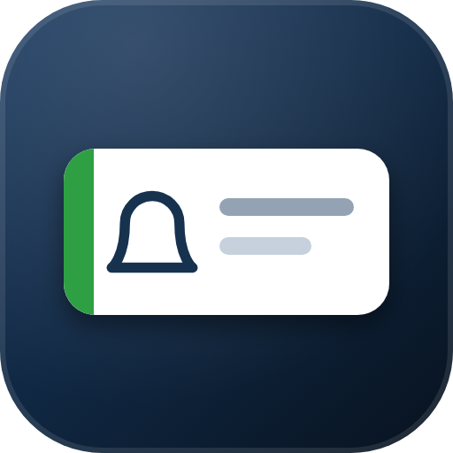
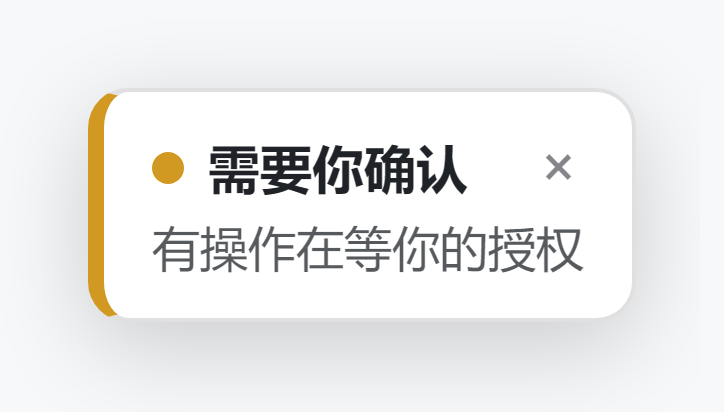
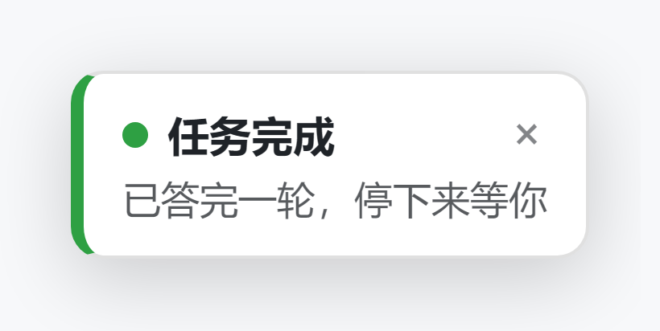
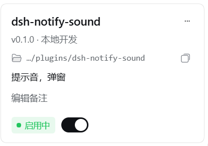

<div align="center">



<h1>dsh-notify-sound</h1>

<a href="README.en.md">English</a>&nbsp;|&nbsp;<a href="README.md">简体中文</a>

<p>
  
  
  
  
</p>

<p><i>A turn finished, the agent is waiting for your approval, or a run broke halfway — play a chime and drop a toast in the corner.<br>You no longer have to stare at the screen to know it is worth coming back.</i></p>

</div>

---

## What it does

| Kind | Trigger | Accent colour |
|---|---|---|
| **Turn finished** | session goes from `running` back to idle with nothing pending | green `#2ea043` |
| **Waiting for confirmation** | a `pendingInteraction` appears (approval / confirm dialog) | amber `#d29922` |
| **Failed / interrupted** | the turn ends but carries an error flag | red `#f85149` |

The sound only serves to call you once: all three kinds share **the same call shape** (a two-note chime); they differ only in the toast text and colour. To tell them apart, edit `CALL_SHAPE` in `lib/client.cjs`.

<div align="center">

&nbsp;&nbsp;

</div>

## Features

- **No audio assets at all** — the chime is synthesised live with the Web Audio API (oscillator + exponential envelope). Zero resource files, zero runtime dependencies.
- **Six tones**: clean / soft / bell / alarm (triple) / minimal (single) / wood (default).
- **No spam**: the same kind chimes at most once per 1.5 s; repeats within 4 s are coalesced into `×N` on the toast.
- **Toasts**: up to 4 at a time, auto-dismiss after 20 s, closable one by one or all at once.
- **Never drifts into the sidebar**: if any ancestor of the mount point has `transform` / `filter`, `position:fixed` stops being viewport-relative, so the plugin measures and compensates every frame and keeps the overlay in the **viewport** corner.
- **First observation is only a baseline**: loading the plugin never floods you with history.

## Install

> Requires the DSH web GUI (the plugin declares `"platform": "web"`; the TUI is not supported).

**Option 1 — one command**

```bash
dsh plugin --profile web add github:Su-1003/dsh-notify-sound
```

Desktop profiles are usually named `desktop`; replace the `--profile` value with yours.

**Option 2 — drop it in manually**

```powershell
git clone https://github.com/Su-1003/dsh-notify-sound.git "$env:USERPROFILE\.dsh\plugins\dsh-notify-sound"
```

Then pick that directory under **Settings → Plugins → Local development** in the GUI. Once installed it shows up as this card:



Restart DSH or reload the web GUI afterwards.

**First run**: browsers only allow audio after a user gesture, so click or press a key anywhere in the GUI once — the plugin unlocks its `AudioContext` then, and the chime works from that point on.

## Changing the tone

There is no settings UI yet; two ways to change it:

1. Edit `DEFAULT_SOUND_SET` in `lib/client.cjs` (one of `clean` / `soft` / `bell` / `alarm` / `minimal` / `wood`) and reload the GUI;
2. Or run `localStorage.setItem("dsh-notify-sound.style", "bell")` in the browser console — the key is fixed and honoured on reload.

## Known limitations

- **Web GUI only.** The host half is a stub (`lib/index.js`); everything happens in the browser half, `lib/client.cjs`.
- **Silent if the page has never been clicked** (browser AudioContext gesture policy). Toasts are unaffected.
- **Background tabs** get their timers throttled by the browser, so the chime can be delayed; whether it actually wakes you also depends on system notifications and tab policies.
- All three kinds share one call shape — intentional, not a bug.

## Layout

```
cordis.patch.yml   inserts the plugin row into the profile roster
lib/index.js       host half: a stub that only exposes a mountable apply
lib/client.cjs     browser half: state tracking + chime synthesis + toast overlay (prebuilt, no build step)
```

The decision logic comes entirely from `uiSession.sessionStatus` transitions in the DSH client: a `pendingInteraction` appearing means confirmation is needed; `running` going from true to false with nothing pending means finished or failed. Activating after `ui-session` is fine too — the plugin polls for up to 15 s waiting for the service to be ready.

## License

[MIT](LICENSE)
