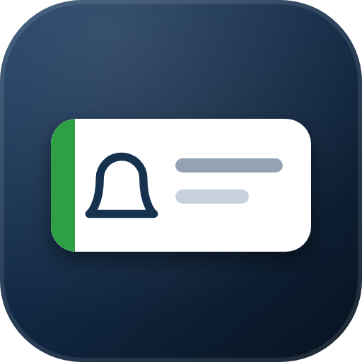
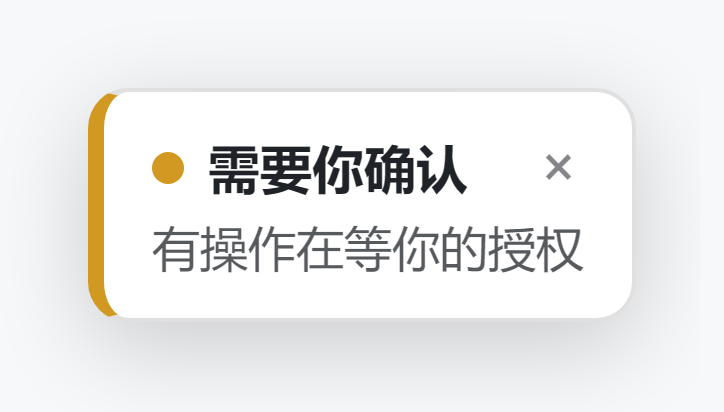
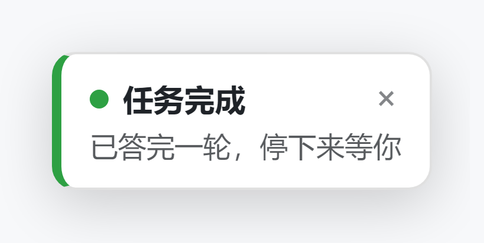
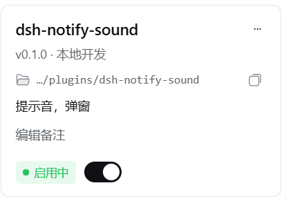

<div align="center">



<h1>dsh-notify-sound</h1>

<a href="README.md">简体中文</a>&nbsp;|&nbsp;<a href="README.en.md">English</a>

<p>
  
  
  
  
</p>

<p><i>任务答完了、有操作在等你授权、跑到一半出错中断 —— 响一声提示音，右上角弹一条通知。<br>不盯着屏幕，也知道该回来看一眼了。</i></p>

</div>

---

## 它做什么

| 场景 | 触发条件 | 通知条颜色 |
|---|---|---|
| **任务完成** | 会话从 `running` 变回空闲，且没有等你的交互 | 绿 `#2ea043` |
| **需要你确认** | 出现 `pendingInteraction`（授权 / 确认弹窗） | 黄 `#d29922` |
| **出错 / 被中断** | 本轮结束但带错误标记 | 红 `#f85149` |

声音只负责「叫你一声」，三种场景**用同一个音型**（同音双响）；区别只体现在通知条的文字和颜色上。想给三种场景配不同声音，把 `lib/client.cjs` 里某个音色的 `sameTone(f)` 拆成 `{ done: [...], confirm: [...], error: [...] }` 即可。

<div align="center">

&nbsp;&nbsp;

</div>

## 特性

- **不需要任何音频文件** —— 提示音用 Web Audio 实时合成（振荡器 + 指数包络），整个插件零资源文件、零运行时依赖
- **12 种音色**：木质（默认）/ 清脆 / 柔和 / 铃音 / 醒目（三连音）/ 极简（单声）/ 三音上行 / 木琴 / 水滴 / 双音下行 / 低频咚 / 轻嗒 —— 每种都能在设置页就地试听
- **设置页可调**：**设置 → 通知提示音** 里能关提示音、关通知条、发送测试通知、一键恢复默认
- **不会刷屏**：同类通知 1.5 秒内只响一次；4 秒内的同类事件在通知条里合并成 `×N`
- **通知条**：最多同时 4 条，20 秒后自动消失，可单条关、也可一键全部关闭
- **只在 DSH 窗口里弹**：通知条是页面内的 DOM 元素，不调用系统通知、不盖到别的软件上；容器 `pointer-events:none`，只有卡片本身可点，不挡其他操作
- **不会跑到左侧栏上**：挂载点上若有 `transform` / `filter` 的祖先，`position:fixed` 会失效，插件每帧测量并补偿，浮层始终贴在**视口**右上角
- **首次观测只做基线**：插件加载时不会给你补一堆历史通知

## 安装

> 需要 DSH 的 Web GUI（插件声明了 `"platform": "web"`，TUI 不适用）。

**方式一：一行命令**

```bash
dsh plugin --profile web add github:Su-1003/dsh-notify-sound
```

桌面端的 profile 名通常是 `desktop`，按你的实际配置替换 `--profile` 后的名字。

**方式二：手动放进去**

```powershell
git clone https://github.com/Su-1003/dsh-notify-sound.git "$env:USERPROFILE\.dsh\plugins\dsh-notify-sound"
```

然后在 GUI 的 **设置 → 插件 → 本地开发** 里选中这个目录安装，成功后就是下面这张卡：



装完重启 DSH，或刷新 Web GUI。

**初次使用注意**：浏览器规定必须有一次用户手势才允许出声，所以请先在界面上点一下或敲一下键 —— 插件会在这时解锁 `AudioContext`，之后才会响。

## 设置

装好之后打开 **设置 → 通知提示音**：

| 项 | 作用 |
|---|---|
| **提示音** 开关 | 关掉只弹通知条，不出声 |
| **通知条** 开关 | 关掉之后既不弹条也不出声 |
| **音色列表** | 12 种，点一行即选中；右侧「试听」当场出声，不用等真有事 |
| **发送测试通知** | 立刻弹一条示例通知，声音和条子一起验 |
| **恢复默认** | 回到木质 + 两项全开 |

偏好存在浏览器 `localStorage`（`dsh-notify-sound.style` / `.sound` / `.banner`），改完立刻生效，不写宿主的设置文档。想在控制台里改也行：

```javascript
localStorage.setItem("dsh-notify-sound.style", "bell");  // 音色
localStorage.setItem("dsh-notify-sound.sound", "off");   // 关提示音
localStorage.setItem("dsh-notify-sound.banner", "off");  // 关通知条
```

## 已知限制

- **只在 Web GUI 生效**。宿主侧半边是空壳（`lib/index.js`），全部行为在浏览器半边 `lib/client.cjs`。
- **页面没被点击过就不会响**（浏览器 AudioContext 手势策略），通知条不受影响。
- **标签页在后台时**浏览器会限流定时器，提示音可能延后；能不能叫醒你还取决于系统通知和标签页策略。
- 三种场景共用同一个音型，这是有意为之，不是 bug。

## 结构

```
cordis.patch.yml   把插件行插入 profile 名册
lib/index.js       宿主半边：空壳，只提供一个可挂载的 apply
lib/client.cjs     浏览器半边：状态跟踪 + 提示音合成 + 通知浮层 + 设置页（预构建，无需构建步骤）
```

判定逻辑全部来自 DSH 客户端 `uiSession.sessionStatus` 的状态迁移：`pendingInteraction` 出现 → 需要确认；`running` 由真变假且无待办 → 完成或出错。插件在 `ui-session` 之后激活也来得及（会轮询 15 秒等待服务就绪）。

## 许可

[MIT](LICENSE)
